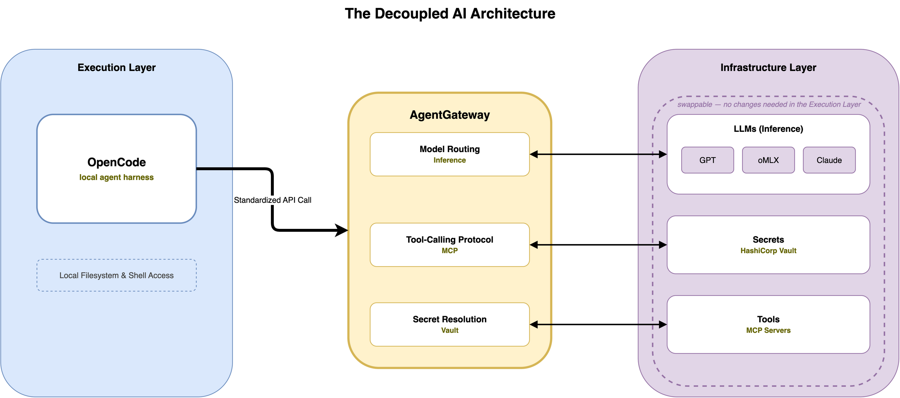

# AI Agent Setup & Workflow

This guide explains the architectural philosophy and configuration of the AI-assisted development stack. While the [Getting Started Guide](../getting-started.md) covers installation, this document focuses on why this specific decoupled architecture is used.

## The Architecture of Decoupling

Most AI setups suffer from "configuration sprawl"-where every tool requires its own API keys, its own model settings, and its own custom logic for handling tool calls. This creates a maintenance burden and a security risk, as secrets are scattered across the filesystem.

### 1. Decoupling Inference from Execution
The core of this stack is the separation of the **Agent** (the execution layer) from the **Gateway** (the inference and tool-calling layer).

- **The Agent (`opencode`)**: Focuses on the "how"-exploring the codebase, executing shell commands, and managing the project state. It doesn't care which model is providing the answers; it only cares that it has a reliable API to talk to.
- **The Gateway (`agentgateway`)**: Focuses on the "what"-handling the actual inferencing, managing the tool-calling protocol, and communicating with the LLM.

**The Benefit: Zero-Plumbing Model Swaps**
Because the agent and the inference system are decoupled, you can swap the underlying model (e.g., moving from a cloud-based GPT to a local oMLX model) or change the tool-calling implementation entirely within the Gateway. The agent remains untouched. You change the "brain" without having to rebuild the "body."

### 2. Centralized Trust & Secret Management
Scattering sensitive API keys across multiple `.env` files is a security failure. It leads to inconsistent versions of keys and increases the likelihood of accidental leaks.

**The Benefit: Consistent Security**
By centralizing secrets in the Gateway (integrated with Vault and SSO), we move the trust from the "edge" (individual tools) to the "core."
- **No more scattered keys**: Tools no longer need to hold high-value secrets.
- **Consistent Access**: The local harness uses a single, low-privilege credential to access the Gateway, which then handles the high-value provider keys internally.
- **Unified Rotation**: Rotating a key happens in one place (Vault/Gateway), and every tool in the stack is updated instantly.

---

## Configuring the Stack

### The Gateway (`agentgateway`)
The Gateway is the central point of trust. Once installed and linked via SSO, you use it to manage:
- **Inference**: Sync and switch between different models (e.g., via oMLX) without affecting your agents.
- **Tool Calling**: Define how the LLM interacts with tools and MCP servers in a single, consistent location.
- **Secrets**: Manage provider API keys securely, ensuring they never touch the local tool configurations.

### The Agent (`opencode`)
OpenCode is the execution interface. When you run `ldx opencode setup`, you are configuring the local harness to point to the Gateway. This removes the need for OpenCode to manage its own API keys or model logic; it simply leverages the Gateway's capabilities.

---

## Modular Add-ons: Skills

This repository ships with the following specialized skills:
- `playwright-cli`: Browser automation and UI testing.
- `docling`: Document parsing and conversion (PDF, DOCX, etc. to Markdown).

These are modular extensions that leverage the existing Gateway/Agent plumbing to provide specific expertise without requiring new configuration.

---

## AI Workflow Summary

| Component | Role | Key Benefit |
| :--- | :--- | :--- |
| **AgentGateway** | Inference & Tool-Calling | Centralized secrets; zero-plumbing model swaps |
| **OpenCode** | Execution & Interface | Decoupled from provider logic; focus on codebase |
| **Skills** | Specialized Capabilities | Modular expertise without new plumbing |
| **OpenChamber** | Visual Management | Orchestration and monitoring |
