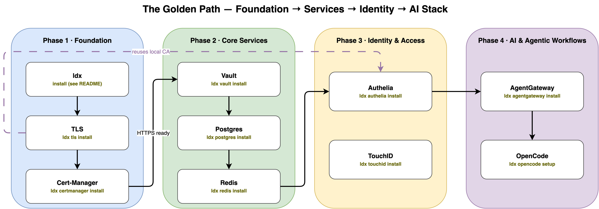

# Getting Started with `ldx`

This guide will take you from a fresh macOS installation to a fully powered local development environment. Instead of installing tools randomly, follow this "Golden Path" to ensure dependencies are handled correctly.

## The Golden Path

### Phase 1: Foundation
Before deploying services, you need the underlying networking and certificate infrastructure.
1. **Install `ldx`**: Follow the installation steps in the [README](../README.md).
2. **Setup TLS**: Run `ldx tls install`. This sets up your local CA and Traefik.
3. **Cluster Certificates**: Run `ldx certmanager install` to handle in-cluster certificates.



### Phase 2: Core Services
Now that you have HTTPS and a cluster, spin up your data and secrets layer.
1. **Secrets Management**: Run `ldx vault install`.
2. **Databases**: Run `ldx postgres install` and `ldx redis install`.

### Phase 3: Identity & Access
Secure your services and your local identity.
1. **SSO Provider**: Run `ldx authelia install`. This integrates with the TLS setup from Phase 1.
2. **SSO Enrollment**: To activate your local identity provider and link existing services, run:
   ```bash
   ldx authelia enroll
   ldx vault sso
   ```
   This registers your local user and links Vault to Authelia for seamless SSO.
3. **Biometric Gating**: Run `ldx touchid install` to secure your git pushes.

### Phase 4: AI & Agentic Workflows
The final layer: bringing in the LLM infrastructure.
1. **The Gateway**: Run `ldx agentgateway install`.
2. **SSO Integration**: Link the gateway to your identity provider:
   ```bash
   ldx agentgateway sso
   ```
3. **The Agent**: Configure your local harness with `ldx opencode setup`.

---

## Quick Summary Table

| Order | Component | Command | Purpose |
| :--- | :--- | :--- | :--- |
| 1 | TLS | `ldx tls install` | Local HTTPS & Routing |
| 2 | Cert-Manager | `ldx certmanager install` | K8s Certificates |
| 3 | Vault | `ldx vault install` | Secret Storage |
| 4 | Postgres/Redis | `ldx postgres/redis install` | Data Persistence |
| 5 | Authelia | `ldx authelia install` | Identity / SSO |
| 6 | Identity Link | `ldx authelia enroll` $\rightarrow$ `vault sso` | User & Vault Registration |
| 7 | AgentGateway | `ldx agentgateway install` | AI Orchestration |
| 8 | Gateway SSO | `ldx agentgateway sso` | Link Gateway to SSO |
| 9 | OpenCode | `ldx opencode setup` | Agent Configuration |
