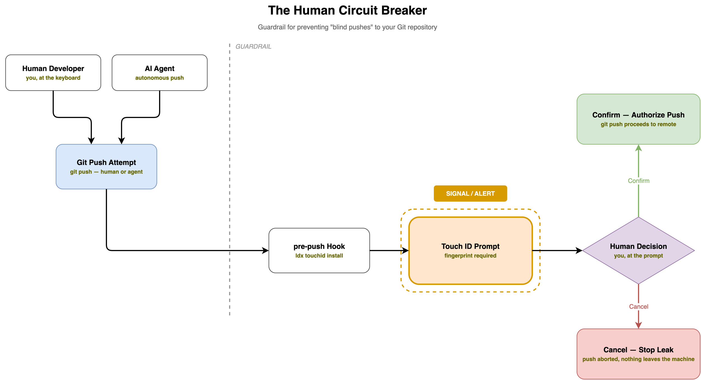

# Local Security Guardrails

Local development is prone to "silent failures"-forgotten vulnerable packages, accidental secret leaks, or blind pushes to a remote. Rather than attempting to create a perfect fortress, `ldx` provides a set of guardrails designed to increase visibility and force intentionality.

## The Guardrail Framework

### 1. Visibility: Eliminating Blind Spots (`cvescan`)
Security failures often happen because of what we forget. A package that was safe six months ago may now have a critical CVE.
- **Setup**: Run `ldx cvescan install`.
- **The Guardrail**: By scheduling scans every few days via a LaunchDaemon, `cvescan` surfaces newly disclosed vulnerabilities in a report you can act upon. This ensures that software which was secure when installed doesn't become a silent liability as new CVEs are published.

### 2. Hygiene: Reducing the Blast Radius (`vault`)
The most common security failure is the plain-text `.env` file. If a project directory is accidentally exposed, every single secret is compromised.
- **Setup**: Run `ldx vault install`.
- **The Guardrail**: Moving secrets into Vault is about hygiene. It separates the *configuration* (which can be shared) from the *secrets* (which are gated). This ensures that a leak of the codebase does not automatically lead to a leak of the credentials.
- **Example Pattern**: We store sensitive credentials-such as MCP server and LLM gateway keys-in Vault, while the local harness uses a throwaway credential for gateway access. This pattern of isolating high-value secrets from daily-use tokens should be replicated across other services wherever possible.

### 3. Intentionality: The Human Circuit Breaker (`touchid`)
Automated agents and muscle memory can lead to "blind pushes"-sending code to a remote without a final, conscious review.
- **Setup**: Run `ldx touchid install`.
- **The Guardrail**: The Touch ID prompt acts as a physical circuit breaker. While it can be bypassed by an agent, for the human developer, it serves as a mandatory "Are you sure?" moment. It forces a pause, ensuring that the push is a deliberate act of will.

Either a human developer or an AI agent runs `git push`. The `pre-push` hook stops the push and shows a Touch ID prompt. The prompt is the guardrail signal: it is the point where the process stops and a person must decide. Cancel aborts the push, and nothing leaves the machine. Confirm authorizes the push, and git sends the commits to the remote.

## Failure Prevention Checklist

- [ ] **Visibility**: Is `ldx cvescan` active to alert me of forgotten vulnerabilities?
- [ ] **Hygiene**: Have all plain-text secrets been migrated to Vault to limit leak impact?
- [ ] **Intentionality**: Is the Touch ID hook active to prevent blind pushes?
- [ ] **Transport**: Is local TLS enforced to prevent credential sniffing on the local network?
